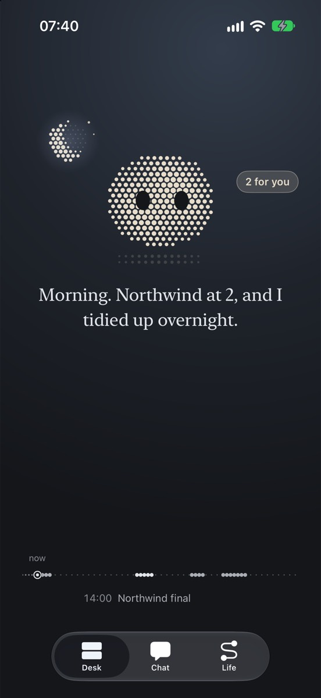
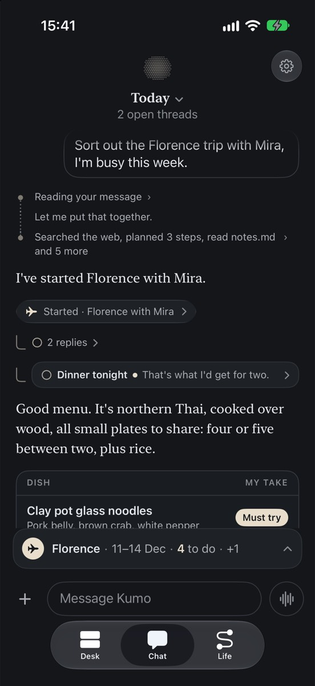
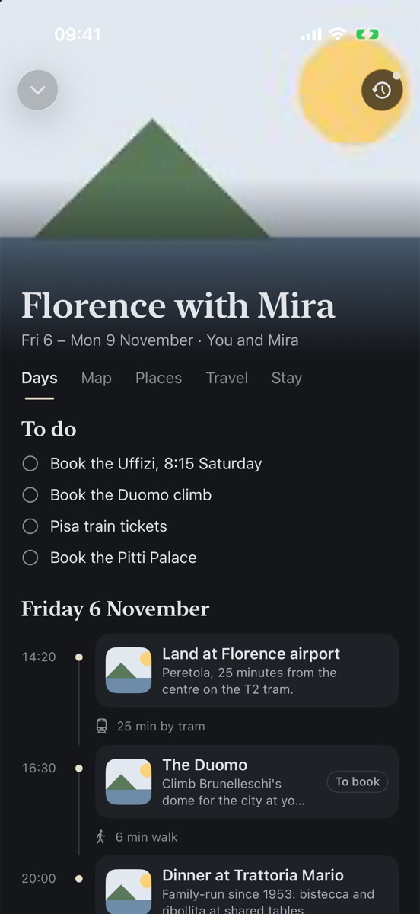
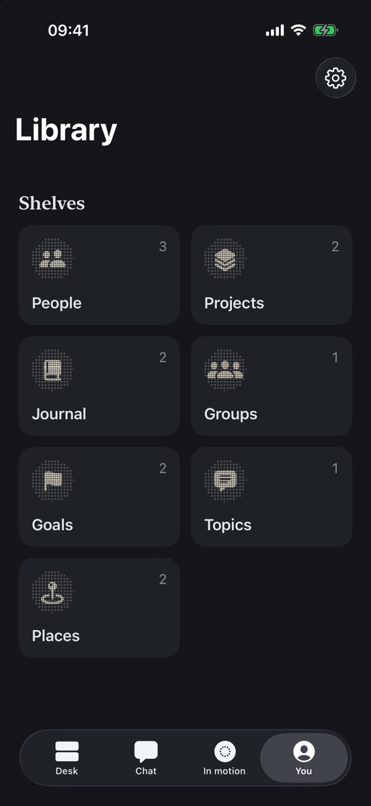
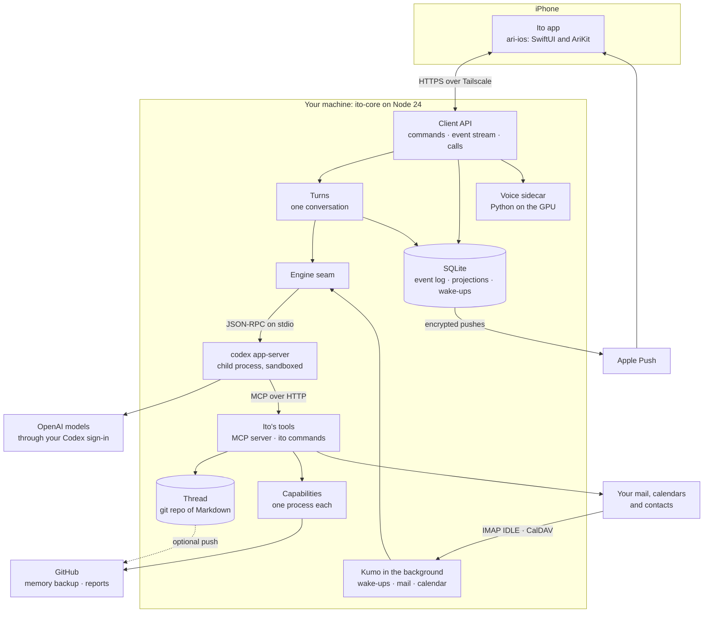
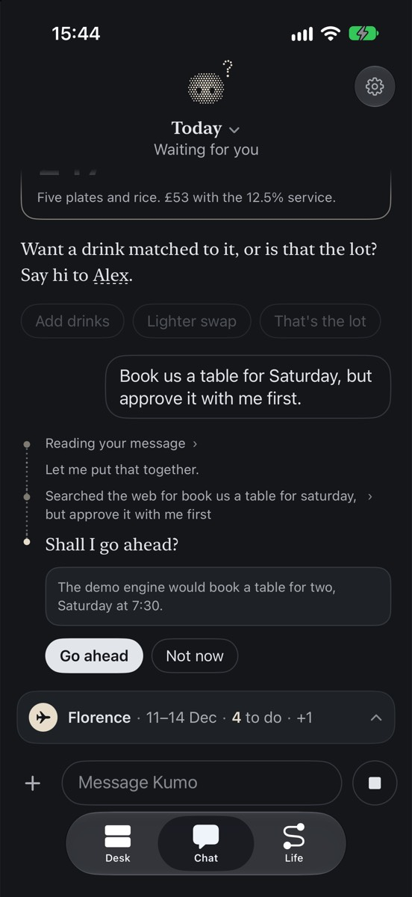
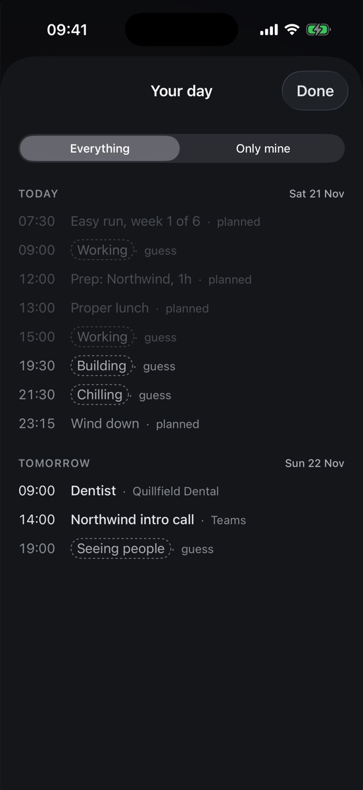

#  Ito

**A personal agent you run on your own machine, with a native iPhone app.**

[](https://github.com/akai-ito/ito-core/actions/workflows/ci.yml)

Life admin is scattered across mail, calendars and your own head, and it needs following up
long after any one conversation ends. Ito is an agent that lives with it. Kumo, the agent, reads
your mail as it arrives, keeps your calendar and plans, remembers what you tell it in a git
repository you own, and comes back to things on its own when they need you. You talk to it in one
continuous conversation in the iPhone app, which also has a Desk for what's waiting on you. Kumo
drafts, files and schedules, and records each action with an undo. It never sends mail, and the
bigger steps wait for your go-ahead.

This repository, **ito-core**, is the server: the agent loop, a durable event log, the client API,
memory, mail and calendar, capabilities and the voice sidecar. The iPhone app is
[ari-ios](https://github.com/akai-ito/ari-ios); Ari is its name in the code.

<p align="center">
  
  
  
  
</p>
<p align="center"><sub>The Desk, a reply with Kumo's trail, a trip in motion, and the memory
Library. Every name and detail is fictional: the server's demo engine and a few made-up memory
pages.</sub></p>

> [!NOTE]
> Ito is a personal project, in use by its author on his own home server. It's single-user by
> design and not packaged for others yet: you run the server from a clone, and build the app in
> Xcode. Nothing here has had an outside security review.

## What works today

- **One live conversation.** Replies stream as they're written, with a trail of what Kumo is
  doing, a Stop that works at once, and messages sent while it's busy steering the turn or
  waiting their turn. Photos and files go in with a message.
- **Mail.** iCloud, Outlook or Gmail over IMAP. Kumo reads each new mail as it arrives, puts
  bookings on your calendar, and drafts replies in your voice into your Drafts folder. It never
  sends mail.
- **Calendar and contacts.** iCloud over CalDAV and CardDAV: events, holds and invite answers,
  Kumo's own calendar for its plan of your day and its guesses, and contact details kept current.
- **Memory.** The Thread, a git repository of Markdown pages and a journal that you can read
  without Ito, with search over it and past conversations, and an optional backup to a private
  GitHub repository.
- **Follow-through.** Kumo sets itself wake-ups, wakes on new mail and calendar changes, and
  messages you when something is worth saying. Every action it takes is recorded, with an undo
  where there can be one.
- **In motion.** Trips, training blocks and other things you're doing, kept as structured
  documents that Kumo changes a part at a time as you talk.
- **Voice.** Calls with Kumo through CallKit, with speech recognition and synthesis on the server's
  own GPU.
- **Notifications.** Every message notifies, encrypted so that Apple's push service only carries
  ciphertext.

Not built yet: model-behaviour evals and tracing, local models, an on-device cache so the app
opens instantly, a light mode and iPad layout, TestFlight builds, and clients beyond the iPhone.

## Try it in five minutes

The demo engine answers from scripts instead of a model, so you can see the server work, and the
app against it, with no accounts. You need Node 24.

```sh
git clone https://github.com/akai-ito/ito-core.git
cd ito-core
npm ci
export ITO_HOME="$HOME/.ito-demo"     # keeps the demo apart from a real install in ~/.ito
node bin/ito.ts serve --engine demo   # the first run, in a terminal, prints a token once
```

In a second terminal, with that token, watch the event stream:

```sh
export TOKEN=ito_...
curl -N -H "Authorization: Bearer $TOKEN" http://127.0.0.1:8787/v0/events
```

And in a third, send a message. The stream shows the message accepted, the turn starting, Kumo's
steps, the reply arriving piece by piece, and `turn.ended` with `completed`:

```sh
curl -H "Authorization: Bearer $TOKEN" -H "content-type: application/json" \
  -d "{\"id\":\"$(node -p 'crypto.randomUUID()')\",\"text\":\"Plan the Florence trip, I'm busy\"}" \
  http://127.0.0.1:8787/v0/messages
```

A message with *trip* in it starts a sample trip in motion, *busy* walks a trail of steps, *mail*
puts a sample draft on the Desk, *plan* lays out a sample day, *approve* asks for an approval, and
*fail* and *long* try a failure and Stop. To see it in the app, build
[ari-ios](https://github.com/akai-ito/ari-ios#build-and-run) for the Simulator and connect it to
`http://127.0.0.1:8787` with the same token.

## How it fits together



The app is a thin client: it renders what the server says and keeps its own copy only of what you
haven't sent yet. The server is one Node process that owns the conversation, and it runs Codex,
each capability and the voice as child processes, each speaking JSON-RPC over its pipes.

| Where | What's there |
| --- | --- |
| [protocol](protocol) | The client API: OpenAPI for commands, JSON Schema for events, the guarantees and the golden transcripts |
| [src/http](src/http), [src/store](src/store) | The routes, the event stream and the SQLite event log with its projections |
| [src/turns](src/turns) | One turn at a time: routing, Stop, steering, asks, approvals, crash recovery |
| [src/engine](src/engine) | The engine seam, the Codex adapter and the scripted engine for tests and the demo |
| [src/tools](src/tools), [src/capabilities](src/capabilities) | The MCP server, the `ito` commands and skills, and the capability host |
| [src/memory](src/memory) | The Thread, recall and backup |
| [src/mail](src/mail), [src/calendar](src/calendar), [src/contacts](src/contacts) | IMAP, CalDAV and CardDAV, drafts and Kumo's calendar |
| [src/wakeups](src/wakeups), [src/desk](src/desk), [src/work](src/work) | Wake-ups, the Desk, and Kumo's work log and learning tracks |
| [capabilities](capabilities) | The capability SDK, Reports and a sample |
| [agent](agent) | Kumo's instructions and the skill files it reads on demand |
| [voice](voice) | The voice sidecar: turn detection, speech recognition and synthesis |

## Engineering decisions

### A protocol first, tested from both sides

Commands go in over HTTP and one resumable event stream comes out. The [protocol](protocol) is
written down before the code: OpenAPI 3.1 for the commands, JSON Schema for the events, numbered
[guarantees](protocol/guarantees.md) the server keeps, and a golden transcript for each scenario.
The transcripts are generated from scenario code ([scenarios.ts](protocol/tools/scenarios.ts)), so
a changed field changes every transcript it touches, and CI fails if they're stale or don't match
the spec. The server replays every transcript through its real HTTP API, and the app replays the
same files, pinned to an ito-core commit, into its own store. That contract is what let the server
and the app be built side by side.

### Durable events and a resumable stream

Every change is an event, appended in the same SQLite transaction (Node's built-in `node:sqlite`)
that updates the tables the API reads from ([store.ts](src/store/store.ts)). The server confirms a
command only once it's on disk. Each message carries an id the app chose, checked in the accepting
transaction, so a retry can never make a second copy. The app reconnects with `Last-Event-ID` and
gets every later event once; when the server can't continue from that cursor (too far behind, or
restored from a backup) it sends a fresh snapshot and says why, rather than resuming from the wrong
place ([events.ts](src/http/events.ts)). Turns outlive connections, and on startup a turn a crash
left open is ended as interrupted, keeping the text it had.

### Codex as the engine, behind a small seam

The agent runs on OpenAI's Codex, driven as `codex app-server` over JSON-RPC, with TypeScript
bindings generated from the pinned Codex version (CI checks they're current). Everything else
talks to an `Engine` of ten functions ([engine.ts](src/engine/engine.ts)): start a turn, steer it,
interrupt it, answer an approval, a structured completion, and a piece of background work. Codex's
own protocol stops at the adapter ([codex-engine.ts](src/engine/codex/codex-engine.ts)), the words
on Kumo's trail come from Ito's own tables rather than from Codex, and a scripted engine stands in
for tests and the demo. The conversation is one long-lived Codex thread in a `workspace-write`
sandbox; background work and quick judgements run in short-lived threads of their own.

### Tools: a small MCP surface, the rest as commands and skills

Ito runs its own MCP server, which Codex calls back into. A test keeps the tools in front of the
model on every turn to at most 20 ([installed.test.ts](test/installed.test.ts)). Larger areas, such
as mail and contacts, are `ito mail ...` and `ito contacts ...` commands the agent runs in its
shell, described in a skill file it reads only when it needs it ([groups.ts](src/tools/groups.ts),
[agent/mail.md](agent/mail.md)), so they cost a line of context until then. A capability is one
typed definition with Zod schemas ([capabilities/sdk](capabilities/sdk)), and from it the server
makes a command, an MCP tool where it's needed, a setup sheet in the app and a step on the trail.
Each capability runs as its own process with only its own setup values, and the host restarts one
that crashes with backoff, giving up after five crashes in ten minutes
([restarts.ts](src/capabilities/restarts.ts)).

### Actions that wait for you



- **Approvals pause the turn.** An action that needs your approval, such as a capability filing a
  public report, or a Codex app asking through an MCP elicitation, waits inside the running turn
  with what it would do; your answer resumes it, and Stop cancels it. An approval can only send out
  pictures you sent ([approvals.ts](src/capabilities/approvals.ts)).
- **Questions end the turn.** When Kumo asks you something, its turn ends and the question waits,
  across restarts, until you answer.
- **Mail is drafts only.** There's no code path that sends mail: replies go into your Drafts folder
  with a card on the Desk, for you to send from Mail. Moving more than 25 mails at once waits for one
  Apply on the Desk ([mail.ts](src/mail/mail.ts)), and merging or deleting a contact waits for a
  question there.
- **Everything is recorded.** Each action Kumo takes goes into its work log with its reason and an
  undo where there can be one. "That was wrong" undoes it, keeps what to do differently on a memory
  page, and steps back how much Kumo does in that area on its own.

### Memory you can read without Ito

The Thread is a git repository of Markdown pages with YAML front matter: people, groups, goals,
projects, places, topics and a journal, plus a portrait of you, what's going on now and how you like
to be helped. Each write is a commit, made one at a time through a queue, so history and diffs come
free and the app shows what changed ([memory.ts](src/memory/memory.ts),
[thread.ts](src/memory/thread.ts)). Recall is hybrid: SQLite FTS5 and a small embedding model run on
the CPU, merged by reciprocal rank fusion ([recall.ts](src/memory/recall.ts)). Memory stays out of
the event log: a step names the pages Kumo used, never what they say. The backup pushes to a private
GitHub repository through a GitHub App installed on that one repository, and it only ever
fast-forwards, refusing rather than merging when both sides changed.

### Follow-through from four building blocks



There are no cron jobs, fixed check-in times or rules about when to speak. Kumo decides, from four
building blocks the server holds it to ([guarantees](protocol/guarantees.md#how-kumo-decides-to-speak)):

1. **It messages you**, one message per thing, and every message notifies.
2. **It sets itself wake-ups**, stored in SQLite: a concrete time, what it's for and why, how it
   repeats in your time zone, and where it came from. When one comes due, Kumo looks first, then
   messages you, moves it or drops it ([wakeups.ts](src/wakeups/wakeups.ts)).
3. **It wakes on what happens:** a new mail over IMAP IDLE, a change on your calendars (polled over
   CalDAV), or a move to another time zone.
4. **It acts and records**, as above.

When Kumo's model can't act, nothing templated goes out in its place: what was due waits, the
problem shows in the app, and Kumo catches up once the model answers.

### Reliability tests

- **Transcript replay.** Every golden transcript runs through the real HTTP API, with the scripted
  engine and a virtual clock, and responses and events must match exactly
  ([transcripts.test.ts](test/transcripts.test.ts)).
- **A real crash.** The server runs as a child process and is killed with `SIGKILL` after
  confirming a message; on restart the message is there, the reply ends as interrupted with its
  text, and no capability process is left behind ([crash.test.ts](test/crash.test.ts)).
- **The real Codex.** The pinned `codex app-server` runs against a mock model: streaming, steering,
  interrupting, tool calls, asks, failures mapped to typed errors, and resuming after a restart
  ([codex-engine.test.ts](test/codex-engine.test.ts)).
- **Mail against an IMAP server** running in the test ([mail-source.test.ts](test/mail-source.test.ts)).
- **CI** also lints the spec, validates every transcript against it, checks generated files are
  current, and runs strict `tsc`, ESLint with functional rules (no `let`, classes or mutation) and
  Prettier.

What isn't tested: the model's judgement. There's no eval suite for Kumo's behaviour yet, and the
app's UI tests run locally against the demo engine, not in CI.

## Privacy and security

- **Where your data goes.** Everything is stored on your machine, in `~/.ito`. What Kumo reads to
  do its work (your messages, the memory pages it uses, the mail it handles) goes to OpenAI's
  models through your Codex sign-in. Push notifications pass through Apple as ciphertext, sealed
  with AES-256-GCM under a key each phone makes. The server also reaches the weather service with
  a location rounded to about 10 km, if you allow it, GitHub if you turn on backup or Reports,
  Hugging Face once, for model downloads, and the web when Kumo searches or reads a page.
- **Reaching the server.** It listens on `127.0.0.1` only; you reach it over your tailnet with
  `tailscale serve`. API tokens are stored as SHA-256 hashes, a pairing code works once for five
  minutes, and wrong tokens or codes are rate-limited.
- **The agent's sandbox.** Codex runs the agent's commands in its `workspace-write` sandbox, in a
  workspace of their own, with network access.
- **Secrets at rest.** Mail app passwords, tokens and the APNs key are stored unencrypted in
  `~/.ito/ito.db`, protected only by file permissions. Capability secrets go to the server once and
  never come back to the app. The log stays on the machine and can hold mail subjects.

## Run the server

Ito runs on a Linux machine you own, with Node 24, [Tailscale](https://tailscale.com) to reach it
from your phone, and an NVIDIA GPU if you want voice:

```sh
git clone https://github.com/akai-ito/ito-core.git ~/ito-core
cd ~/ito-core
npm ci --omit=dev
node bin/ito.ts login    # signs Codex in, in Ito's own home
node bin/ito.ts serve    # the first run prints your token, once
node bin/ito.ts pair     # in another terminal: a QR code for the app
```

[docs/running.md](docs/running.md) has the rest: reaching it over Tailscale, the systemd unit,
updating, mail and calendar, notifications, voice, memory backup, logs and where Ito keeps its data.

## Tests

```sh
npm test                    # every transcript through the server, a crash, Codex against a mock
npm run check:transcripts   # every transcript against the spec
npm run typecheck && npm run lint && npm run format:check
```

The Codex tests run the agent's commands in Codex's sandbox, which on Linux needs unprivileged user
namespaces; CI turns them on.

## Licence

Source-available under your choice of the
[PolyForm Noncommercial](LICENSES/PolyForm-Noncommercial-1.0.0.md) or
[PolyForm Small Business](LICENSES/PolyForm-Small-Business-1.0.0.md) licence; see
[LICENSE.md](LICENSE.md).
