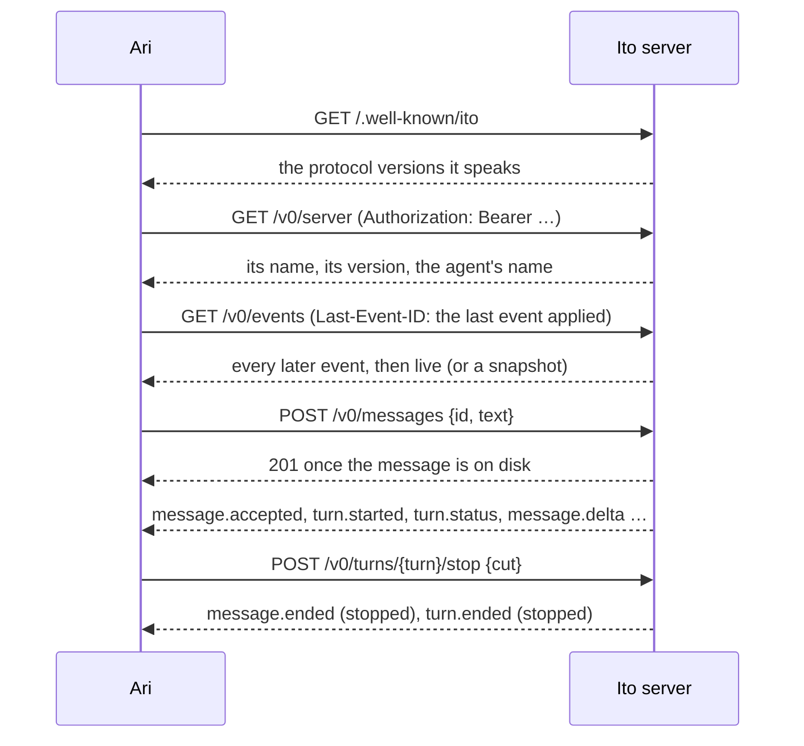

# The Ito client API

**Commands in, one resumable event stream out.** Ari speaks it, and so can any other client.

| File | What it is |
| --- | --- |
| [openapi.yaml](openapi.yaml) | The commands, as OpenAPI 3.1 |
| [events.schema.json](events.schema.json) | Every event on the stream, as JSON Schema |
| [guarantees.md](guarantees.md) | What the server and the protocol promise |
| [transcripts](transcripts) | One golden transcript per scenario: what crosses the API, step by step |
| [types.ts](types.ts) | TypeScript types generated from the spec |
| [tools](tools) | The scenarios that generate the transcripts, and the checks that run in CI |

## How it fits together

- **Discover** which protocol versions a server speaks, before there is a token.
- **Authenticate** every other request with the token `ito serve` printed. Tokens travel only
  over HTTPS, or to a loopback address during development.
- **Listen** on one Server-Sent Events stream that carries everything the server says. Each event
  has an id that is never reused; send the last one you applied as `Last-Event-ID` and you
  receive every later event exactly once. When the server can't resume from it, the stream starts
  with a `snapshot` instead.
- **Send** messages under an id the app chooses, so retrying is always safe. The server answers
  once the message is on disk; what it does next arrives on the stream.
- **Stop** a turn, or **try again** after one failed, with commands addressed to the turn.

## Events

Every event carries `id`, `type` and `at`, plus the fields of its type.

| Type | When |
| --- | --- |
| `snapshot` | The server can't resume from your cursor, or you sent none |
| `message.accepted` | A message you sent is on the server's disk |
| `message.queued` | It can't join the running turn, so it waits as Next |
| `message.read` | The agent took it into the running turn |
| `turn.started` | The agent starts working; Stop works from here |
| `turn.status` | What the agent is doing now, in plain words |
| `message.started` | The agent begins a reply, or a note while it works |
| `message.delta` | Text appended to a message, at an offset |
| `message.ended` | A message is finished: completed, stopped, interrupted or failed |
| `turn.ended` | The turn is over, and its status is cleared |

## Versioning

Routes carry the protocol's major version, and every response carries an `Ito-Protocol` header
with the full `MAJOR.MINOR`. Until 1.0, every protocol change may break, so an app and a server
must speak the same `0.MINOR`; from 1.0, a minor version only adds. Apps ignore fields and event
types they don't recognise, and servers ignore unknown request fields.

## Working on it

- `npm run generate` rewrites the transcripts from [tools/scenarios.ts](tools/scenarios.ts) and
  the types from the spec.
- `npm run check:transcripts` checks every transcript against the spec and the guarantees it can
  see: offsets, unique ids, exactly-once delivery, every turn ending.
- `npm run docs` builds the API reference into `site/`.
