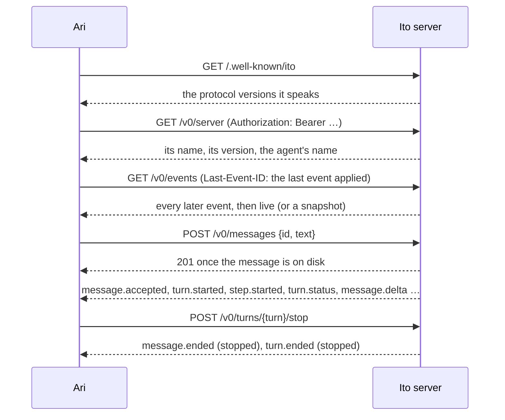
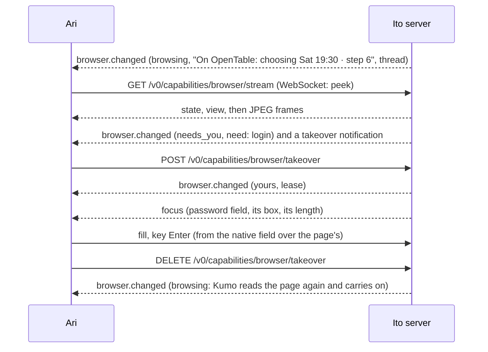

# The Ito client API

**Commands in, one resumable event stream out.** Ari speaks it, and so can any other client.

| File | What it is |
| --- | --- |
| [openapi.yaml](openapi.yaml) | The commands, as OpenAPI 3.1 |
| [events.schema.json](events.schema.json) | Every event on the stream, as JSON Schema |
| [push.schema.json](push.schema.json) | What a push notification carries, encrypted and decrypted |
| [blocks.schema.json](blocks.schema.json) | The `ari:` blocks a reply may hold: places, choices, pictures, picks, tables with verdicts, a key number, events, Desk cards, people, made pages, things in motion, files to look at and changes to approve, and what your taps on them send |
| [made.schema.json](made.schema.json) | What a page Kumo made holds: its sections, items to tick and pictures |
| [motion.schema.json](motion.schema.json) | What a thing in motion holds, for each kind, and the changes Ari makes to it |
| [stream.schema.json](stream.schema.json) | The frames on a call's stream, both ways |
| [browser.schema.json](browser.schema.json) | The frames on the live view of Kumo's browser, both ways |
| [guarantees.md](guarantees.md) | What the server and the protocol promise |
| [transcripts](transcripts) | One golden transcript per scenario: what crosses the API, step by step |
| [types.ts](types.ts) | TypeScript types generated from the spec |
| [tools](tools) | The scenarios that generate the transcripts, and the checks that run in CI |

## How it fits together

- **Discover** which protocol versions a server speaks, before there is a token.
- **Authenticate** every other request with the token `ito serve` printed. Tokens travel only
  over HTTPS, or to a loopback address during development.
- **Listen** on one Server-Sent Events stream that carries everything the server says. Each event
  has an id that is never reused; send the last one you applied as `Last-Event-ID` and you
  receive every later event exactly once. When the server can't resume from it, the stream starts
  with a `snapshot` instead.
- **Send** messages under an id the app chooses, so retrying is always safe. The server answers
  once the message is on disk; what it does next arrives on the stream.
- **Share** from the phone's share sheet: any mix of a link, text, photos and files and a note, under
  an id the app makes, so a retry never makes a second. The server reads the link's page for its
  title and summary; Kumo puts the share in the open side thread it belongs in, or a new one it
  names, where it becomes your message with `share` on it, and answers it in that thread's turn.
- **Stop** a turn, or **try again** after one failed, with commands addressed to the turn.
- **Attach** photos and files: upload each under an id the app makes, then name them in a message.
  Anything over 20 MB, such as a recording, goes up in chunks that resume after any drop; `GET
  /v0/uploads` says what the server takes, and how big, before anything is sent.
- **Recordings:** an audio attachment you send is transcribed on the server, with times and, as a
  best guess, who spoke; `recording.changed` follows it to `ready`. Kumo reads the transcript, and
  the app can too, correct what it misheard, name its voices, and delete it.
- **Pair** a new app with the short-lived code in the QR code `ito pair` shows, for a token of its
  own.
- **Answer** what the agent asks by sending a message, or cancel the ask. Asking ends the agent's
  turn, and the ask waits for you as long as it takes.
- **Notify** a device: the app registers it with a key it made, and every reply, ask and message
  from Kumo reaches it at once. Notifications travel encrypted.
- **Say where you are:** the phone sends its time zone and, roughly, its place. Kumo lives by that
  time zone, and the Desk shows the weather there.
- **Plan with Kumo:** list, move and cancel the wake-ups Kumo set, which the Desk shows as its plans.
- **Kumo's dream:** once a day, at a time you set (04:00 until you choose another), Kumo looks back
  over the whole day and puts it in order: memory, tomorrow's blocks and wake-ups, and your journal,
  written as your own diary. Read the latest dream's record with `GET /v0/dream` (what it planned,
  tidied, noticed and saved for you, each line pointing at what it changed, with an undo through
  Kumo's work), mark it seen, ask for one now, and set the dream time. While one runs,
  `dream.progress` brings each step as a short line for a live view, and `GET /v0/dream` has the
  latest; `dream.finished` says when one is done. Neither notifies.
- **Talk in threads:** a side thread is a conversation of its own beside the main chat. Send into
  one, reply to a message to start one, open one with its messages, rename it, mark it done or open,
  and move a message between threads; list and search them for Threads by day.
- **Open what Kumo made:** list the Made shelf, fetch a page with its content and your ticks, and
  tick its items.
- **Understanding you:** what Kumo would like you to explain waits quietly as questions on its
  learning tracks (`GET /v0/understanding`), each with what Kumo already understands, the missing
  piece and why it would help. Answer with taps, your own words or a recording you uploaded, or say
  none fit, not sure or not now; `question.changed` follows each one. Nothing there is due, and
  nothing notifies.
- **Follow Kumo's browser:** when Kumo books, fills in a form or shops for you on a site, its task
  shows as a line in the thread it lives in (`browser.changed`), and a tap peeks at the live view
  over a WebSocket. When Kumo needs your hand, for a login, a code, a CAPTCHA or the pay button, a
  `takeover` notification opens straight into it: take the page over, sign in or pay with the
  phone's own keyboard laid over the page's field, and hand it back. Kumo never presses a button
  that pays. A free booking or form can come as a one-tap `commit` card on the Desk, pressed for
  you only if the page is still as it was.
- **Give Kumo full access** to the server, or put it back in its sandbox, from its next turn: read
  it with `GET /v0/access`, turn it on with `POST /v0/access/full` and a body that says it's meant,
  and off with `DELETE /v0/access/full`. `access.changed` tells every app, so the chat can show a
  marker while it lasts.

## Events

Every event carries `id`, `type` and `at`, plus the fields of its type.

| Type | When |
| --- | --- |
| `snapshot` | The server can't resume from your cursor, or you sent none |
| `message.accepted` | A message you sent is on the server's disk |
| `message.queued` | It can't join the running turn, so it waits as Next |
| `message.read` | The agent took it into the running turn |
| `turn.started` | The agent starts working; Stop works from here |
| `turn.status` | What the agent is doing now, in plain words |
| `step.started` | The agent starts a step (thinking, a search, a command, an edit…), with its title |
| `step.updated` | More is known about a running step |
| `step.ended` | A step is over, with its outcome, duration and past-tense title |
| `ask.started` | The agent asks you something; its turn ends next |
| `ask.ended` | The ask is answered by a message, or cancelled |
| `message.started` | The agent begins a reply, or a note while it works |
| `message.delta` | Text appended to a message, at an offset |
| `message.ended` | A message is finished: completed, stopped, interrupted or failed |
| `turn.ended` | The turn is over, and its status is cleared |
| `thread.started` | A side thread starts: Kumo branched one, or you replied to a message or started one |
| `thread.changed` | A thread's name, state, line, replies, result, picture or news changed |
| `message.moved` | A message moved between the main chat and a thread, or between threads |
| `recording.changed` | A recording you sent moved on: queued, transcribing, ready, failed or deleted |
| `made.created`, `made.changed` | Kumo made a page, or kept one current, with a note of what changed |
| `made.state` | Your ticks on a page changed, from any device |
| `made.removed` | You let Kumo forget a page |
| `browser.changed` | Kumo's browser moved on: a step on a site, a takeover asked for, taken or handed back, a commit card, or the task over |
| `access.changed` | You turned Kumo's full access on or off |
| `question.changed` | A question in Understanding you was added, answered, filed, heard, set aside, settled or dropped |
| `dream.finished` | Kumo finished a dream, with its record |
| `dream.progress` | A dream under way started a step, such as tidying a page or moving a wake-up |

## Kumo's browser

The browser is a capability, so it's there only while it's on: `GET /v0/server` lists it as
`browser`. One Chromium on the server, signed in where you signed in, always at iPhone size, so the
page Kumo reads is the page you take over.

- **The line.** `browser.changed` carries the whole state, and the snapshot holds it while it isn't
  idle. Show its `line` in the thread named by `thread`, or in the main chat when there's none: what
  Kumo is doing while it browses, that it needs your hand, that you have the page, or that a card
  waits for your OK. It never notifies, except that a need notifies once.
- **Peek.** `GET /v0/capabilities/browser/stream` upgrades to a WebSocket that sends the page as
  JPEG frames from Chrome's own screencast, plus `state`, `view` and `focus` text frames. Watching
  changes nothing.
- **Take over.** `POST /v0/capabilities/browser/takeover` gives you the page: Kumo's actions on it
  are refused until you hand it back with `DELETE`, and your `tap`, `touch`, `scroll`, `text`,
  `fill`, `key` and `navigate` frames reach it. Each one moves the lease on; left alone for ten
  minutes, it goes back to Kumo by itself. When a field takes the focus, `focus` says its kind
  (`password`, `code`, `email`, `number`…), its box in the viewport and its length, so a native field
  laid over it can use iOS's keyboard and its filling of passwords and codes. What you type goes to
  the page and nowhere else.
- **Hand back.** Kumo's view of the page is gone, so it reads the page again before acting, woken
  in the task's thread when it was waiting on you.
- **Money is your hand.** Kumo stops on the final page and asks you to take over with need
  `payment`; the browser refuses any press that pays, whatever Kumo declares.
- **Commit cards.** A free booking or form can wait on the Desk as a `commit` card: a picture of the
  page with the button outlined, Kumo's summary and the details. The option that `acts` has the box
  press exactly that button, if the page is still as it was; otherwise nothing is pressed and Kumo
  looks again.

## Versioning

Routes carry the protocol's major version, and every response carries an `Ito-Protocol` header
with the full `MAJOR.MINOR`. Until 1.0, every protocol change may break, so an app and a server
must speak the same `0.MINOR`; from 1.0, a minor version only adds. Apps ignore fields and event
types they don't recognise, and servers ignore unknown request fields.

## Working on it

- `npm run generate` rewrites the transcripts from [tools/scenarios.ts](tools/scenarios.ts) and
  the types from the spec.
- `npm run check:transcripts` checks every transcript against the spec, with every object closed so
  a typo can't pass, and against the guarantees table. Replaying them through the server checks the
  rest.
